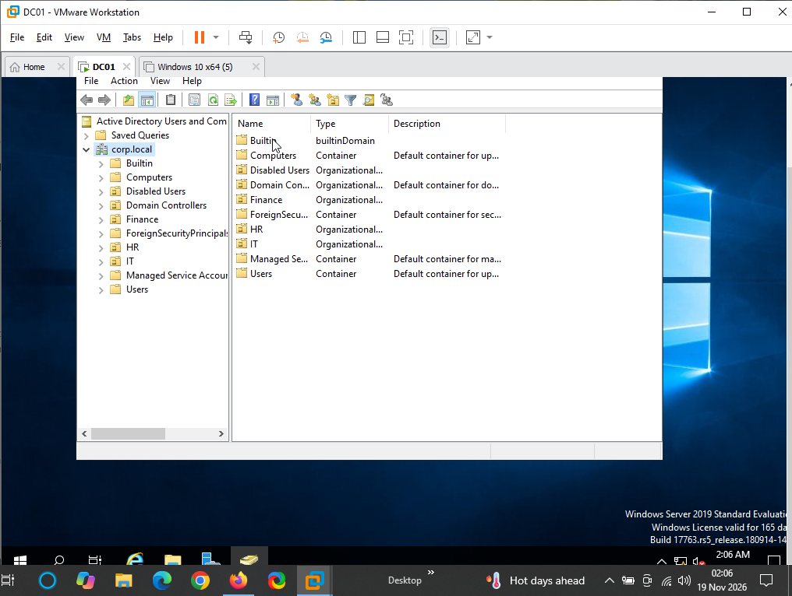
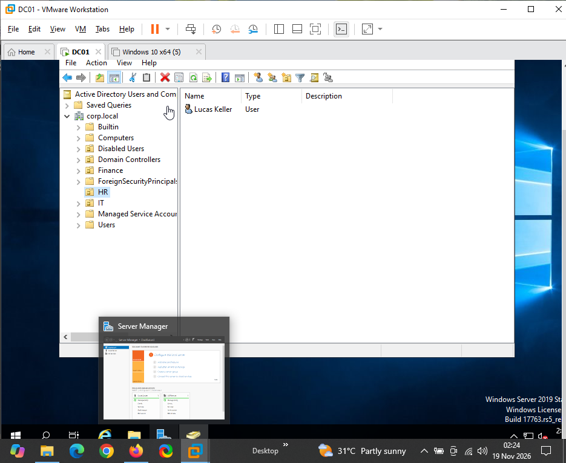
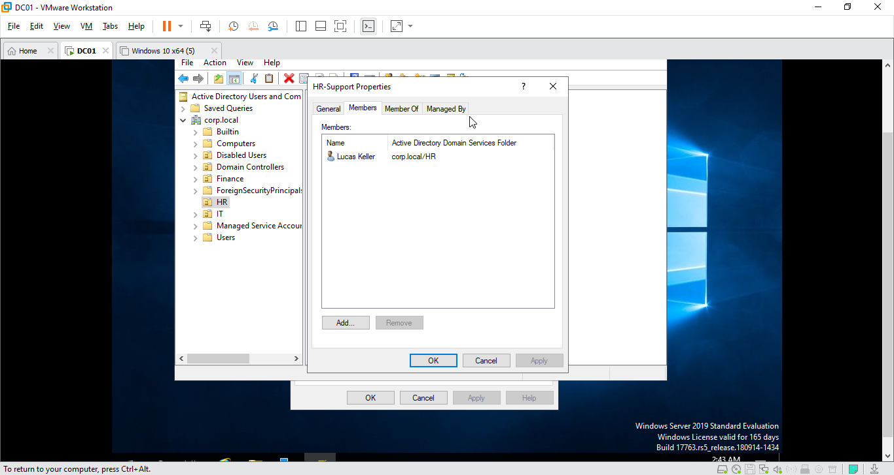
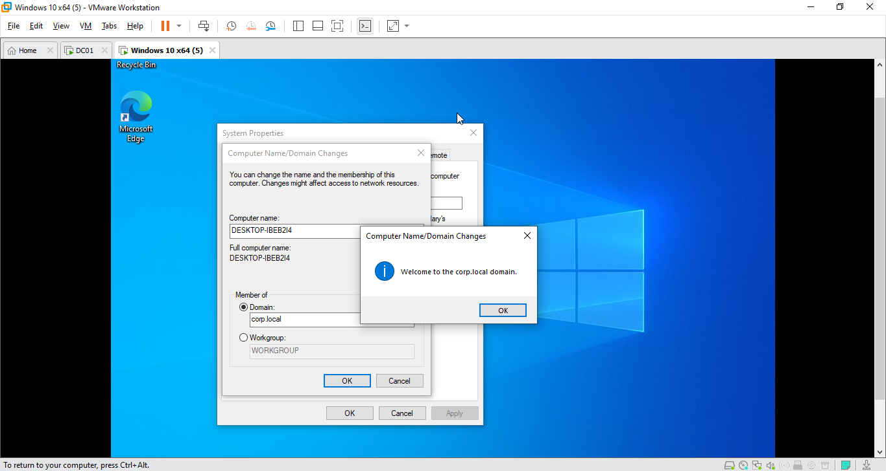
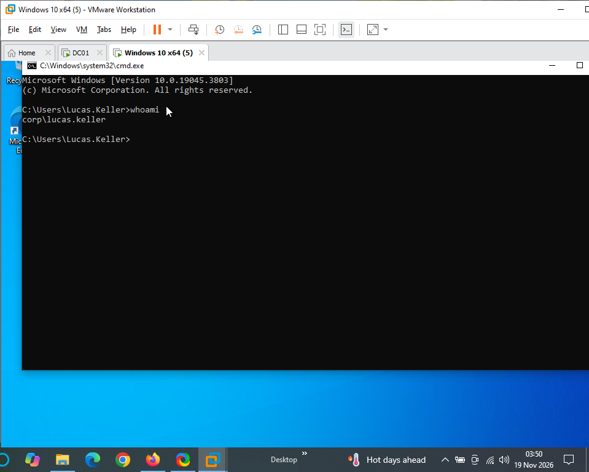

# Active Directory Home Lab: User Provisioning & Lifecycle Management

This repository documents an end-to-end Active Directory lab built to simulate daily **IT Help Desk and junior system administration workflows** inside a Windows domain environment.

The build covers the full user lifecycle—from domain setup, onboarding, and access control to lockout recovery, administrative password resets, and offboarding.

## Lab Environment

| Component | Configuration |
|---|---|
| Hypervisor | VMware Workstation |
| Domain Controller | `DC01` — Windows Server 2019 Standard Evaluation |
| Client Workstation | `DESKTOP-IBEB2I4` — Windows 10 Pro x64 |
| Domain | `corp.local` |
| Directory Services | Active Directory Domain Services (AD DS), DNS |
| Primary Tools | Active Directory Users and Computers (ADUC), PowerShell, Command Prompt |

---

## Core Tasks & Skills

- Organizational Unit (OU) hierarchy design and account segmentation
- Domain user provisioning and role-based access control (RBAC) via security groups
- Client DNS configuration and Windows 10 domain join
- Domain authentication and session verification (`whoami`)
- Account lockout policy enforcement, detection, and unlock recovery
- PowerShell-based password resets and attribute verification
- Account offboarding, access revocation, and archival

---

## Lab Walkthrough

### 1. Organizational Unit Structure

**Screenshot:** `01-ou-structure-created.png.png`

Built a clean OU structure under `corp.local` to separate departments and isolate offboarded accounts:

- `HR`
- `Finance`
- `IT`
- `Disabled Users`



---

### 2. Domain User Creation

**Screenshot:** `02-new-user-created.png`

Provisioned the domain account for **Lucas Keller** (`Lucas.Keller@corp.local`) directly inside the `HR` OU to simulate onboarding a new hire.



---

### 3. Security Group Membership

**Screenshot:** `03-security-group-membership.png`

Added Lucas Keller to the `HR-Support` security group so access permissions are governed by job role rather than assigned directly to individual accounts.



---

### 4. Windows Client Domain Join

**Screenshot:** `04-domain-join-confirmation.png`

Pointed the Windows 10 workstation (`DESKTOP-IBEB2I4`) to `DC01` for DNS resolution and joined it to the `corp.local` domain through System Properties.



---

### 5. Domain User First Login

**Screenshot:** `05-domain-user-first-login.png`

Rebooted the client machine, authenticated with `corp\lucas.keller`, and ran `whoami` in Command Prompt to confirm the active domain session.



---

### 6. Account Lockout & Recovery

**Screenshot:** `06 - Account Lockout and Recovery.png`

Enforced a domain-wide lockout policy via PowerShell using `Set-ADDefaultDomainPasswordPolicy`:

- **Lockout threshold:** 5 failed attempts
- **Lockout duration:** 15 minutes
- **Observation window:** 15 minutes

After triggering a lockout through repeated bad password attempts, located the locked account with `Search-ADAccount -LockedOut` and cleared the lock using `Unlock-ADAccount`.


---

### 7. Administrative Password Reset

**Screenshot:** `07-Active Directory Password Reset.png`

Executed an administrative password reset for `Lucas.Keller` in PowerShell using `Set-ADAccountPassword -Reset` and verified the updated `PasswordLastSet` timestamp with `Get-ADUser`.

> **Note:** Placeholder lab credentials were used in this isolated test environment.


---

### 8. Account Disabling & Offboarding

**Screenshot:** `08- Account Disabled and Offboarding.png`

Completed user offboarding in ADUC by disabling the **Lucas Keller** account, confirming that domain login was blocked, and moving the object into the `Disabled Users` OU for audit recordkeeping.


---

## Help Desk Ticket Scenarios Covered

| Ticket / Scenario | Action Taken |
|---|---|
| New hire onboarding | Provision domain user and assign security group membership |
| Department segmentation | Organize directory objects using Organizational Units |
| Workstation deployment | Configure client DNS and join Windows 10 to `corp.local` |
| Login verification | Authenticate with domain credentials and verify via `whoami` |
| Locked user account | Query locked accounts and unlock via PowerShell |
| Forgotten or compromised password | Reset password via PowerShell and verify `PasswordLastSet` |
| Employee offboarding | Disable account in ADUC, verify access block, and move to `Disabled Users` OU |

---

## Troubleshooting Log

During Step 6, PowerShell initially threw a `NamedParameterNotFound` error on `Set-ADDefaultDomainPasswordPolicy` due to an incorrect parameter flag. Checking the cmdlet syntax and explicitly passing `-Identity "corp.local"` along with properly formatted `hh:mm:ss` duration values resolved the error and applied the policy.

---

## Repository Structure

```text
04-active-directory-lab/
│
├── README.md
│
└── screenshots/
    ├── 01-ou-structure-created.png.png
    ├── 02-new-user-created.png
    ├── 03-security-group-membership.png
    ├── 04-domain-join-confirmation.png
    ├── 05-domain-user-first-login.png
    ├── 06 - Account Lockout and Recovery.png
    ├── 07-Active Directory Password Reset.png
    └── 08- Account Disabled and Offboarding.png
```

---

## About This Project

Built as part of an **IT Support / Systems Administration portfolio** to demonstrate practical Windows Server management, Active Directory troubleshooting, and clear operational documentation.
